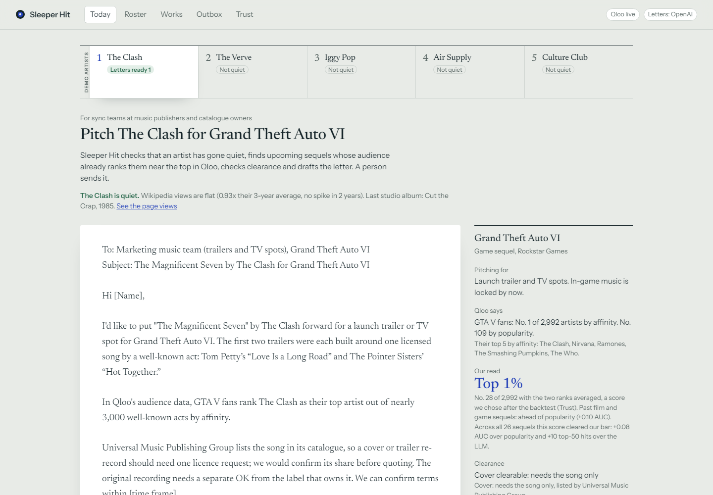

# Sleeper Hit

An agent for sync teams at music publishers and catalogue owners. It checks that a famous artist has gone quiet, finds upcoming sequels whose audience already ranks that artist near the top in Qloo, checks clearance and drafts the pitch letter. A person picks the song, edits the letter and sends it.

Qloo measures the audience. Our code ranks the windows and decides. The language model drafts the letter and is the baseline in the tests. A person sends.

Built for the Qloo Agentic Hackathon 2026.

**What we can show:** on 26 sequels already out, the earlier title's Qloo audience rank, averaged with popularity, put the artists each sequel went on to use higher than popularity alone or an LLM did. Audience rank alone pointed the same way but did not clear our bar. Example: the soundtrack of *Guardians of the Galaxy Vol. 2* includes Fleetwood Mac; ranked from the first film's Qloo audience, Fleetwood Mac was in our top 50 of about 3,000 artists, and neither popularity's top 50 nor the LLM's 50 picks found any artist from that soundtrack. (Qloo's data is today's, so fans of the first film have also seen Vol. 2; that bias favours Qloo.) The method was committed before any song list was collected. The score was picked after the test, and series and titles newer than the LLM showed no clear edge. See [Does Qloo pick better?](#does-qloo-pick-better)

**Live demo:** https://sleeper-hit.onrender.com (no login; if it was asleep, the first load takes a minute or two).

**30 seconds:** open the app. The first screen is today's letter for The Clash, with the evidence beside it. Roster shows every open window: the five demo artists, the quiet catalogue artists from our scan that fit it best, and how many decisions would change on popularity alone. The artist strip at the top of Today shows each of the five demo artists with today's status (letters ready, sent, not quiet, clearance unconfirmed); click The Verve to see the agent refuse (not quiet). Works scores your own list of artists with the same score and ranks the letters across it. Trust holds the backtest.



More in `docs/screenshots/`, all taken from the live app on Oct 29: Roster, a refused artist (The Verve), the outbox, Trust, phone width, and Works on desktop and phone (`7-works.png`, `8-works-phone.png`).

## The problem

A publisher or catalogue owner holds many artists who were huge and are now quiet. A placement in a trailer, a game launch or a returning series can wake one up: *Stranger Things* did it for Kate Bush in 2022, and the GTA VI trailers did it for Tom Petty and The Pointer Sisters. Sync teams pitch these windows by hand, from memory and contacts, and usually learn about a window when the music is already chosen.

The sequel is the opening. The earlier title's audience is already in Qloo's graph, so before the sequel's music is picked we can ask: does that audience already rank this artist near the top?

Recorded-music sync revenue was US$641 million worldwide in 2025 ([IFPI Global Music Report 2026, via Digital Music News](https://www.digitalmusicnews.com/2026/03/18/global-music-industry-revenue-2025/)). That figure is the label side only; publishers earn sync fees on top. One licensing company puts upfront fees for a known song by an established artist at $5,000 to $1,000,000, with trailers among the higher-paying uses ([Soundstripe](https://www.soundstripe.com/blogs/sync-licensing)).

**Who pays (our plan, not tested with customers):** the sync team at a publisher or catalogue owner, as a monthly subscription per catalogue. One extra placement a year from a sleeping artist would cover it. We have not yet put the tool in front of a sync team.

## What it does

Pick an artist in the strip at the top of Today. The strip shows every demo artist's status for today, so you can see who gets letters without switching: "Letters ready N" (N is the number of letters Today would draft), "Sent N" (counted from your own outbox), "Not quiet", "Clearance unconfirmed", or a short reason. For the chosen artist, the agent:

1. **Checks that the artist is quiet**: flat English Wikipedia page views and no new studio album in 5 years (rules below). An artist that is not quiet gets no letters; a person can still knock anyway.
2. **Lists open windows on sequels** and what each one pitches for. Games: the launch trailer and TV spots, because in-game music is licensed long before release. Films: the first trailer, estimated from the release date. Series: the episodes, treated as locked within 60 days of the premiere.
3. **Scores each window with Qloo.** The earlier title is the signal. Qloo ranks about 3,000 well-known artists by that audience's affinity; the card shows the artist's affinity rank and popularity rank ("Qloo says") and our score, the two ranks averaged, as "top X%" ("Our read"), plus the five artists that audience ranks highest by affinity, for context. The agent knocks only inside the top 20% on the card score, and only when the audience itself ranks the artist in its top 20% by affinity (so popularity cannot carry a letter alone).
4. **Checks clearance** from public sources plus the user's own share: one-stop, cover clearable, needs another party's consent, or unconfirmed. Every category shows its source. Unconfirmed gets no letter.
5. **Checks timing.** Every date is marked "announced" or "estimated".
6. **Decides.** Clearance, then timing, then the card score, then age and gender overlap (Qloo demographics) to break ties. At most three letters per artist a day, and every skipped window gets a one-line reason.
7. **Drafts the letter.** The first line is the song and what it is pitched for, plus one sourced fact about how the title has used music so far. One line of audience data follows. Raw Qloo scores never appear.

The **Roster** tab turns it around: for every open window, the demo artists ranked by the card score, with who gets a letter today and why the others do not; the five best-fitting of the 55 quiet catalogue artists from our Oct 23 scan (clearance not entered, so no letters); and how many of today's decisions would change on popularity alone. On Oct 24 that was 2 of 25: without Qloo, The Clash would also get letters for Sonic the Hedgehog 4 and Godzilla x Kong: Supernova, whose audiences rank it only in their top 34% and 31%.

The **Works** tab does the same for a publisher's own catalogue. Paste up to 10 artist names, optionally with your share of the song and the recording and a song title (`The Clash, 100, 0, London Calling`). Each artist is scored with exactly the code Today uses (`scoreRecord` and `decideArtist` in `src/pipeline.js`): the same score we backtested, the top-20% bar, the quiet rule, clearance from your share, and timing. The result reads like a tracklist: Side A is every letter across the catalogue, best first by Today's ordering rules, each with its reason, the audience's top 5 artists for context and a drafted letter (OpenAI drafts the top 3, the template the rest); Side B is every artist that gets no letter today and why; the liner notes give each artist's quiet verdict, best window and clearance. A name without a share is scored but gets no letter, because clearance is unconfirmed. One difference from Today: Works skips the age-and-gender request, which only breaks exact ties, so that artists already in the pool need no new Qloo call. Works keeps no schedule; "Re-scan" runs it again on demand.

Sleeper Hit never sends email itself. In the outbox, "Copy letter" puts the letter on the clipboard and "Mark sent" moves it to sent, where the outcome (no reply, passed, on hold, quote requested, placed) is tracked. "Open in email app" opens a `mailto:` draft in your own email program, with the subject and body filled in and the address you typed (or none), and you send it.

## How Qloo is used

| Step | Request |
|---|---|
| Resolve names | `GET /search?query=…&types=urn:entity:artist` (or `urn:entity:tv_show`, `urn:entity:movie`, `urn:entity:videogame`). Only an exact name match, with the expected year for titles, is accepted; anything else is shown to a person. |
| Artist pool | `GET /v2/insights?filter.type=urn:entity:artist&filter.popularity.min=0.9&take=50&page=…` (most popular first) |
| Score | `GET /v2/insights?filter.type=urn:entity:artist&signal.interests.entities=<earlier title>&filter.results.entities=<up to 50 artist ids>`, repeated over the whole pool |
| Demographics | `GET /v2/insights?filter.type=urn:demographics&signal.interests.entities=<artist>,<titles>` |
| Tried, not used | `/v2/trending` (frozen values) and `filter.type=urn:tag` (too generic to explain a match); see [What we learned](#what-we-learned-about-qloos-data) |

### From request to result (ids redacted)

    GET https://hackathon.api.qloo.com/v2/insights
      ?filter.type=urn:entity:artist
      &signal.interests.entities=<GTA V id>
      &filter.results.entities=<50 pool artist ids>
      &take=50

Each response lists the requested artists under `results.entities[]`, and we read `entity_id`, `name`, `popularity` and `query.affinity` (values not shown here). Repeated over the pool, 2,992 artists came back scored for GTA V; the rest had too little data. We rank all of them by `query.affinity` and by `popularity`, average the two ranks and break ties by affinity. Ranked by affinity, The Clash is No. 1; by popularity, No. 109. Averaged, it is No. 28, the top 1%.

Demographics: `GET /v2/insights?filter.type=urn:demographics&signal.interests.entities=<The Clash id>,<GTA V id>` returns relative scores per age band and gender under `results.demographics[].query`. We turn each into shares against an even baseline and take the overlap of the two distributions: 76% for The Clash and GTA V. The Clash is quiet, UMPG lists its songs, and on Oct 24 GTA VI was 26 days from launch, so the agent drafts a letter pitching a launch trailer or TV spot. The same request for *Sonic the Hedgehog 3* puts The Clash in the top 34%, so the agent skips Sonic 4 and says why.

### The card score

With the earlier title as the signal, rank the pool by Qloo affinity and by Qloo popularity, average the two ranks, break ties by affinity (`blendRanks` in `src/scoring.js`).

**We changed this score after seeing the backtest.** Until Oct 23 the card and the seal used excess affinity: the artist's affinity percentile among artists of similar popularity. It did not clear the registered bar. Of the four Qloo uses registered before the backtest, only the rank blend cleared it, so the card and the seal now use the blend. Picking the winner after the fact favours it; the sealed forecast, settled after release, is the test it has not seen. The original score stays in the seal (`excessRank`) and will be reported next to the blend, but does not decide the verdict.

## Does Qloo pick better?

`npm run backtest` asks whether an earlier title's Qloo audience ranks the artists its sequel newly used (artists not on the earlier title's list) above the rest of the 3,000-artist pool. It compares Qloo with popularity, an LLM given both titles (`gpt-4.1-mini`, the sealed baseline's prompt) and "what similar titles used". The method, including the candidate list, inclusion rules, four Qloo uses, popularity thirds and an after-LLM-cutoff split, was committed in `seal/backtest-v2-method.json` (commit `034f21e`) before any list was collected; the script refuses to run if that file changes.

36 candidates; 26 pairs scored (20 films and games, 6 series), 249 sequel artists to find, 18 franchises. 10 were left out: 5 had no lawful song list, 1 had no new pool artists, and 4 were not run because of the Qloo call budget (Space Jam 2, Spider-Man 2 and 3, Transformers 2). Candidates were processed in the registered order, and the budget rule (1,400 calls) was committed with the method.

Pooled AUC (0.5 = chance) with 95% intervals from resampling franchises:

| Method | AUC | Sequel artists in the top 50 |
|---|---|---|
| Popularity | 0.69 [0.62, 0.73] | 12 |
| LLM only | 0.54 [0.52, 0.55] | 23 |
| What similar titles used | 0.56 [0.53, 0.60] | 15 |
| Qloo raw affinity | 0.76 [0.68, 0.83] | 37 |
| Qloo excess affinity (card score until Oct 23) | 0.71 [0.64, 0.79] | 28 |
| Qloo affinity x popularity | 0.76 [0.68, 0.83] | 37 |
| **Qloo affinity and popularity rank blend (card score)** | **0.77 [0.70, 0.82]** | **33** |

The registered bar: a Qloo use beats popularity on AUC and the LLM on top-50 hits, both with the interval's lower end above zero. Differences are computed before rounding.

| Qloo use | AUC over popularity | Hits over the LLM | Cleared |
|---|---|---|---|
| Raw affinity | +0.07 [0.00, +0.17] | +14 [-2, +32] | No |
| Excess affinity | +0.03 [-0.05, +0.14] | +5 [-10, +20] | No |
| Affinity x popularity | +0.08 [+0.01, +0.17] | +14 [-2, +31] | No |
| **Rank blend** | **+0.08 [+0.04, +0.14]** | **+10 [+3, +19]** | **Yes** |

**Where Qloo helps most:**

- **Famous artists, the ones this tool pitches.** Every top-50 hit of the card score (33) and of the LLM (23) was in the most popular third of the pool, which holds the 500 artists the selection rule picks from (The Clash is No. 109 by popularity). Within that third, the card score also beat popularity by +0.09 AUC [+0.02, +0.16].
- **Films and games.** On the 20 film and game sequels: +0.10 AUC [+0.05, +0.18] over popularity, and 23 top-50 hits against the LLM's 16 (+7 [0, +16]).
- **A steady audience signal.** A second registered check (`seal/sibling-check-method.json`, commit `8893210`) compared 19 close sibling pairs (consecutive Twilight films, GTA V and Red Dead Redemption 2, Bridgerton and The Gilded Age, …) with 923 unrelated pairs. Qloo's top-50 lists overlapped 4.4x more for siblings (raw affinity; p < 0.001; bar 3x and p < 0.01), with only a weak link to release-year distance. The LLM reached 1.8x, because it names the same famous artists for most titles.

**Limits:**

- Series (6 pairs, +0.048 [-0.008, +0.101] AUC over popularity) and titles released after the LLM's training cutoff (9 pairs, +0.046 [-0.006, +0.101]) did not show Qloo clearly ahead of popularity. Most sealed titles are one or the other.
- The backtest checks songs used in the sequels themselves (soundtrack albums and episode lists). The app also pitches trailers and TV spots, where picks follow other rules.
- The LLM is `gpt-4.1-mini` at temperature 0. It returns a 50-name shortlist, not a full ranking, so we could not test an LLM-plus-popularity blend against ours. Its prompt is in `seal/backtest-v2-method.json`.
- Less famous artists: ranking only the middle or least popular third, the card score beat popularity by +0.24 and +0.21 AUC. But the LLM, asked for 50 names from the whole pool, put all 50 in the most popular third, so it never competed there. Given only the least popular 1,000 names, it found as many sequel artists as Qloo (12 vs 12). "Least popular" is the bottom of a popular pool (Qloo popularity 0.9 or higher), not the long tail.
- Four Qloo uses were tested without correcting for that, so this is a narrow pass, and the card score was chosen after the test.
- Known biases, written down first: Qloo's audience data is current (favours Qloo, strongly for series, whose signal includes the new season); the LLM may remember soundtracks released before its cutoff; a shortlist of 50 caps the LLM's AUC near 0.5, which is why top-50 hits is the LLM comparison.

### Reproduce it

Inputs are committed: the method (`seal/backtest-v2-method.json`), the candidate list (`src/data/backtest_v2_candidates.js`) and the song lists (`src/data/backtest_v2_lists.json`, artist names and sources only). The pool is the cached first 3,000 artists for `filter.popularity.min=0.9`, built on Oct 22; its hash goes into the seal. A clean run needs `QLOO_API_KEY` and `OPENAI_API_KEY`: about 1,350 Qloo calls (4 a second, about 6 minutes) and 52 OpenAI calls (`gpt-4.1-mini`, temperature 0, about US$0.30). Qloo's data changes over time, so a later run can differ a little from the numbers above.

### Decisions made after seeing data

| When | What changed | Why |
|---|---|---|
| Oct 23 | Card and seal score: excess affinity to the rank blend | Only the blend cleared the registered bar |
| Oct 23 | Quiet rule: added "no studio album in 5 years" | The blend let current stars through the page-view rule |
| Oct 23 | Demo artist: The Verve to The Clash, picked by hand (9th of 55) | The Verve is not quiet; The Clash's recordings have been licensed for the screen |
| Oct 24 | Window rules per medium (game launch marketing, series locked within 60 days) and the top-20% knock bar | In-game and episode music is chosen long before release |
| Oct 24 | Letters cite the audience (affinity) rank, not the blended score | The blend mixes in popularity, so it is not "the audience's" rank |
| Oct 28 | Affinity floor: a letter also needs the audience's own top 20% by affinity (not backtested) | Reviewers found letters the blend gave on popularity alone (an artist ranked No. 1,095 by affinity for one title); the agent should not pitch those as audience fits |

## What we learned about Qloo's data

- Affinity depends on the signal, not on the other artists in the request: the same artist scored inside two different candidate lists got an identical value. So a large pool can be scored in chunks of 50 and stay on one scale.
- Affinity is not popularity in disguise. On 3,000 artists and 12 titles, the median rank correlation between affinity and popularity was 0.16, and the median agreement between two titles' rankings was 0.20. The bar, set before the test, was 0.5.
- `urn:tag` insights did not explain matches well enough for a letter. For the GTA V audience, music-genre tags (`filter.tag.types=urn:tag:genre:music`) came back empty, and unfiltered tags were mostly unrelated (hobbies, endorsements). For Yellowjackets the music genres were the broad popular ones (pop, hip hop, indie). The card shows ranks only. With one signal title, explainability would credit that one title, so we left it off.
- The pool is the first 3,000 artists Qloo returns for `filter.popularity.min=0.9`, most popular first. It is not the complete top 3,000: the paging skips some very popular artists (Drake and Metro Boomin are missing).
- A returning series is one Qloo entity across seasons, so its audience already includes the new season. Series are reported apart in the backtest for that reason.
- `/v2/trending` (Oct 23, `npm run check:trending`, 25 artists): the weekly series moves from Sep 2023 to Feb 2025, returns nothing from March to mid-October 2025, and since Oct 17 2025 every series holds one repeated value that keeps the early-2025 order (rank correlation 0.98 with Dec 2024). In the moving period it also missed a known wake-up: Tom Petty's best week came 80 days after his GTA VI trailer. We do not use trending.
- `urn:demographics` returns relative scores per age band and gender, not shares. We convert them to shares against an even baseline (our assumption). The resulting overlap varies little between artists (76% and 75% for two demo artists on GTA V), so it only breaks ties.

**Usage:** about 6,370 live Qloo calls while building and testing (our own call log), on `/search`, `/v2/insights` and `/v2/trending`. One request was rejected (a trending query over a full year). After a restart the app re-scores the pool once, about 370 calls throttled to 4 a second, then serves from its private cache.

## Known limitations

- Qloo results describe aggregate audiences. A high rank is a reason to knock, not a prediction that a supervisor will pick the artist.
- Qloo stops at the artist; a person picks the song. The app has no licensing history, so it cannot warn that a song has been used too often lately.
- The candidate windows are a hand-kept list of announced sequels with public dates (`src/data/windows.js`, each with sources); the agent does not discover new titles yet. Series trailers and promos are not a separate window yet.
- The backtest pass is narrow, the card score was chosen after it, and series and newer titles showed no clear edge over popularity.
- Clearance categories help set priorities. They are not legal advice. Public rights data is incomplete; when in doubt the card says "Unconfirmed".
- The quiet rule, the window rules (60-day series lock, 14 to 60 days for trailers and launches) and the top-20% bar are our choices, shown in the Trust tab. Wikipedia page views measure reading attention, not plays.
- The pool is not the complete top 3,000, and "least popular" in it still means well known.
- Song lists come from MusicBrainz soundtrack releases and Netflix Tudum articles. Albums can differ from what is used on screen; some Tudum lists are highlights.
- The sealed forecast cannot be scored during judging; results come after release.

## Setup

Requires Node.js 22 or newer. No dependencies to install.

```sh
git clone <this repo>
cd sleeper-hit
cp .env.example .env      # put your Qloo hackathon key in QLOO_API_KEY (and OPENAI_API_KEY if you have one)
npm test
npm start                 # http://localhost:3000
```

- Without `QLOO_API_KEY` (or with `QLOO_MODE=mock`) the app runs on an offline mock and shows a "Qloo MOCK data" badge. Mock numbers mean nothing.
- Without `OPENAI_API_KEY`, letters come from a plain template and the app says so.
- The first live start scores the pool for every open window, about 370 Qloo calls throttled to 4 per second (roughly a minute and a half), plus one Wikipedia request per artist; later loads use the private cache.

## Data handling

Qloo's developer guide says: "Do not store Qloo response data in a public repository." This repo holds no Qloo response data, entity ids or keys:

- All responses are cached privately on the server in `.private/` (git-ignored). The browser receives ranks, percentiles, overlap and categories only.
- Works sends the server only artist names, plus the viewer's own share and song if given. The server scores them and keeps nothing; the list and the result stay in the viewer's browser (localStorage). The response holds ranks, percentiles, categories and reasons, never entity ids, raw affinity or popularity values, or tags (`test/works.test.js` checks this).
- The artist strip (`GET /api/artists/summary`) reuses the per-artist runs Today already holds and makes no Qloo call of its own. An artist not scored yet comes back "pending" and is scored in the background with the same run Today would make. The response holds names, letter counts and short labels only (`test/summary.test.js` checks this).
- Works limits: 10 artists per scan; 30 artist analyses per visitor and 300 for the whole site per day; 120 new Qloo calls a day for artists outside the cached 3,000-artist pool (one `/search` plus one scoring request per open window, 6 today). Pool artists cost no new Qloo call. Over a limit, the API answers with a plain error. Override with `WORKS_IP_DAILY`, `WORKS_SITE_DAILY` and `WORKS_QLOO_DAILY`.
- The sealed forecast publishes only SHA-256 hashes (`seal/hashes.json`). The files stay private and encrypted in `.private/`.
- `npm run check:public` scans the repo for entity ids, raw affinity or popularity values, raw responses, trending values and keys before publishing.

| File in `seal/` | Holds |
|---|---|
| `backtest-v2-method.json`, `sibling-check-method.json` | The registered methods (no results) |
| `backtest-v2.json` | AUCs, intervals, hit counts and the names of sequel artists hit, per method and pair |
| `sibling-check.json` | Overlap ratios and p-values |
| `premise.json` | Median correlations and the verdict |
| `trending-check.json` | Counts of trending series that answered or changed, and dates |
| `quiet-check.json` | Wikipedia page-view ratios (Wikimedia data, not Qloo) |
| `hashes.json` | The sealed forecast: seal time, three SHA-256 hashes and the settlement rules (no ranks) |

## Details

### Quiet, from Wikipedia page views and the catalogue

Rule, fixed before the demo artist was re-checked: in the 36 complete months before today, no month in the last 24 above 1.5 times the 36-month average (no recent wake-up), and the last 3 months at or below that average (not rising now). Months are compared as views per day. `npm run check:quiet` runs it on the demo artists and on known wake-ups: Kate Bush after Stranger Things (May 2022, caught at 9.6x) and Tom Petty after the first GTA VI trailer (Dec 2023, caught at 1.8x). The Pointer Sisters after GTA VI trailer 2 (May 2025) were flagged for a different month; the trailer month itself reached only 1.26x, so the rule can miss smaller wake-ups. Ratios move as the 36-month window rolls forward: on Oct 28 the app showed May 2025 at 1.55x for them, because older, busier months had left the average.

Catalogue condition, added after the rank-blend score let current stars through: a quiet artist must also have released no new studio album in the last 5 years. A studio album is a [MusicBrainz](https://musicbrainz.org/doc/MusicBrainz_API) release group with primary type Album and no secondary type, leaving out groups that hold only bootlegs. The artist is found through the Wikidata id Qloo carries. Not found, or no dated studio album: unknown, not counted as quiet. A posthumous or reunion studio album counts as new. Release groups dated after the check date are ignored (not out yet, or bad data: on Oct 23 a Beatles album dated November 2026, found nowhere else, would otherwise have dropped them).

Limits: page views measure reading attention, not listening, and lean English-speaking. A rights holder can use its own royalty statements instead, and the card then says so.

### The demo artist is our pick

`npm run find-sleepers` applies the selection rule: among the pool's 500 most popular, the best open window in the top 20% on the card score, and quiet by the rules above. On Oct 23, 491 of the 500 passed the window filter (the blend favours well-known artists, so the quiet rules do the work); 140 of the 463 with enough Wikipedia history were quiet by page views, and 55 of those had no studio album in 5 years.

The default demo, **The Clash**, is 9th of the 55 and our pick, not the rule's. We chose it because its original recordings have been licensed for the screen, which makes the pitch letter believable: Stranger Things season 1 used "Should I Stay or Should I Go" ([Netflix Tudum](https://www.netflix.com/tudum/articles/stranger-things-every-song)). The Beatles, ranked above it, licensed a master recording to a TV show for the first time only in 2012, for Mad Men ([The World, citing the Wall Street Journal](https://theworld.org/stories/2012-05-07/mad-men-spends-big-beatles-song)). The Verve, the earlier demo, is not quiet: July 2025 reached 2.32x its 3-year average.

### Sealed forecast

- **Sealed Oct 28, 2026, 16:19:33 UTC** (live Qloo data, 3,000-artist pool, 12 titles, all baselines ready). The files stay private and encrypted; the SHA-256 hashes and the settlement rules are public in `seal/hashes.json` and on the Trust tab:

  | File | SHA-256 |
  |---|---|
  | Pool list (`pool.json`) | `ace1faf500641079ca9ab4692a555753bdf3b0c39326360074555545001bc5ae` |
  | Per-title ranks (`ranks.json`) | `1e8f4510c233ad0cc60b5e73766197f3dd91bd3d5df5007f24028f601e356bca` |
  | Baseline predictions (`baselines.json`) | `db7e2014f5176e06cd0c177c113addfbf005fed5cbb77377bac2112d93cee7b2` |

  The sealed ranking is the card score; `seal/hashes.json` states that this score was chosen after the backtest, why, and what the original score scored.
- **Judging, Nov 2–5:** almost nothing can be checked. Black Doves season 2 is the only sealed title out (Nov 5), and its first season's list suggests about one new pool artist, too few to count.
- **After release:** a person adds each released title's public song list to `src/data/new_soundtracks.js`; `npm run settle` checks the hashes and scores the forecast with the backtest's scorer. Pass: pooled AUC 0.65 or higher and above popularity, the LLM and similar titles; fail: 0.55 or lower, or not above popularity or the LLM. The original excess-affinity ranking is reported next to it. Names and ranks are unsealed at the first settlement.
- **Jan 31, 2027:** final settlement. Fewer than 10 new artists by then means no result.

### Data sources

- **[Netflix Tudum](https://www.netflix.com/tudum):** song lists for the 6 series in the backtest and for Black Doves season 1 in the seal (12 articles), each read once, 3 seconds apart. netflix.com/robots.txt allows our crawler. Only artist names are kept.
- **[MusicBrainz](https://musicbrainz.org/doc/MusicBrainz_API):** soundtrack albums for the 20 films and games in the backtest and the earlier titles' lists for the seal (about 300 lookups), and each artist's latest studio album for the quiet check (about 830 lookups). Official `/ws/2` web service, one request every 1.1 seconds with a descriptive User-Agent, as the API documentation asks. Core data is CC0.
- **[Wikimedia Pageviews](https://doc.wikimedia.org/generated-data-platform/aqs/analytics-api/reference/page-views.html) and Wikidata:** monthly English Wikipedia views for the quiet check, one request per artist, cached.
- **Not used:** Tunefind (its robots.txt blocks our crawler) and the iTunes Search API (robots.txt disallows `/search`).

### Other commands

```sh
npm run premise                  # key-day checks: is affinity more than popularity? is the sample big enough?
npm run find-sleepers            # scan the pool for famous artists that are quiet now (Qloo + Wikipedia + MusicBrainz)
npm run check:trending           # what /v2/trending returns for the demo artists and their peers
npm run check:quiet              # the Wikipedia quiet rule on the demo artists and known wake-ups
npm run backtest                 # past sequels: Qloo vs an LLM vs popularity (method hashed first)
npm run seal                     # dry-run seal into .private/
SEAL_PASSWORD=… npm run seal -- --final   # final seal; writes seal/hashes.json (hashes only)
SEAL_PASSWORD=… npm run settle            # score the seal against released titles' song lists
npm run check:public             # scan for anything that must not be public
```

### Deploy on Render (free plan)

During judging, a plan that does not sleep avoids the cold start below.

The free plan has a temporary disk and sleeps when idle. The server keeps no user data: the outbox, "knock anyway" choices, your own rights share and your Works list are saved in your browser and sent with each request. Works limits are counted in memory, so a restart resets them. The private Qloo cache is only a speed-up; after a restart the first request re-scores the pool (about 370 calls, throttled). The Trust tab reads only committed, public files under `seal/`.

1. Push this repo to GitHub (`.env` and `.private/` are git-ignored).
2. In Render, choose New > Blueprint and select the repo. `render.yaml` defines one free web service (`npm start`, health check `/healthz`, Node 22).
3. Set `QLOO_API_KEY` (and `OPENAI_API_KEY`) as secret environment variables. `QLOO_BASE_URL` is preset to the hackathon URL.
4. Open the service URL. The first visit after the service wakes can take a minute or two.

## License

MIT. See [LICENSE](LICENSE).
